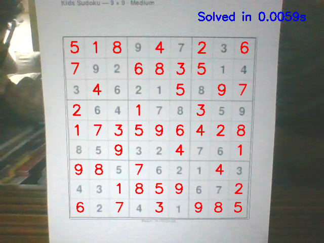
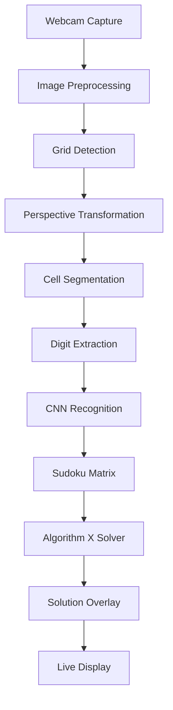

# Real-Time Sudoku Solver

A real-time Sudoku solving application combining Computer Vision, Deep Learning, and Constraint Satisfaction.

The application detects printed Sudoku puzzles using a webcam, recognizes their digits using a trained Convolutional Neural Network, solves them using Algorithm X, and projects the solution onto the original camera feed.



## Features

- Real-time Sudoku grid detection.
- Automatic perspective correction.
- Individual grayscale cell extraction.
- CNN-based digit recognition.
- Unique-solution validation using Algorithm X.
- Augmented reality solution overlay.
- Responsive multithreaded processing.
- Solution caching.
- CPU-based inference.
- Static-image regression testing.

## Architecture



## Technologies

| Technology | Purpose |
|---|---|
| Python | Application development |
| OpenCV | Computer vision |
| NumPy | Numerical operations |
| TensorFlow | Neural network inference |
| CNN | Digit classification |
| Algorithm X | Constraint satisfaction |

## Project Structure

```text
sudoku-solver-opencv/
├── core/
│   ├── process.py
│   └── sudoku.py
├── helpers/
│   └── process_helpers.py
├── models/
│   ├── model.py
│   ├── model_wrapper.py
│   └── model.hdf5
├── preprocessing/
│   └── preprocess.py
├── tests/
│   └── regression.py
├── test_imgs/
├── original/
├── docs/
│   └── demo.png
├── app.py
├── requirements.txt
└── README.md
```

## Installation

The project was tested on Ubuntu with Python 3.8.20.

Create a virtual environment using Python 3.8:

```bash
python3.8 -m venv .venv38
source .venv38/bin/activate
python -m pip install -r requirements.txt
```

## Usage

```bash
source .venv38/bin/activate
python app.py
```

Place a printed Sudoku puzzle in front of the webcam with all four corners visible.

### Controls

| Key | Action |
|---|---|
| Q | Quit |
| S | Capture a raw webcam image |

## Testing

Run static-image regression tests without accessing the webcam:

```bash
python -m tests.regression
```

## Verified Results

| Test | Correct Digits | Correct Cells | Solved |
|---|---|---|---|
| Clean Sudoku | 36/36 | 81/81 | Yes |
| Photographed Sudoku | 33/33 | 81/81 | Yes |
| Webcam Sudoku | 36/36 | 81/81 | Yes |
| Total | 105/105 | 243/243 | Yes |

These results represent the three regression test images. Recognition performance may vary under different lighting, camera resolutions, and puzzle designs.

## Improvements

- Improved contour selection for perspective-distorted puzzles.
- Connected-component analysis for digit isolation.
- Standardized CNN input dimensions and digit sizes.
- Improved low-resolution webcam recognition.
- Invalid and ambiguous Sudoku rejection.
- Bounded Sudoku search execution.
- Responsive camera processing.
- Modular project organization.

## Acknowledgments

Based on the original Sudoku Solver using OpenCV project by dharm1k987.

The Sudoku-solving algorithm is based on Ali Assaf's Algorithm X implementation.

- Original project: https://github.com/dharm1k987/sudoku-solver-opencv
- Algorithm X implementation: https://www.cs.mcgill.ca/~aassaf9/python/sudoku.txt